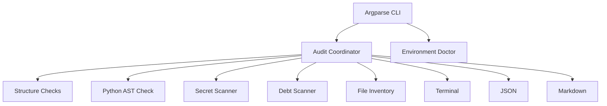

# Architecture

The CLI intentionally uses only the Python standard library at runtime. Repository source is read as text and Python is parsed with `ast.parse`; project code is never imported or executed by the auditor.
